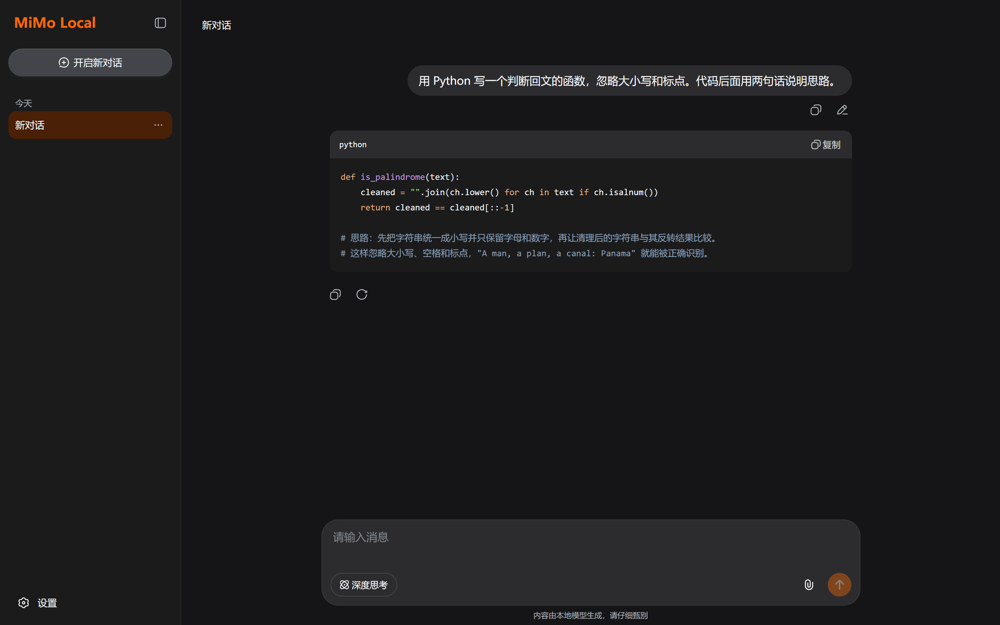
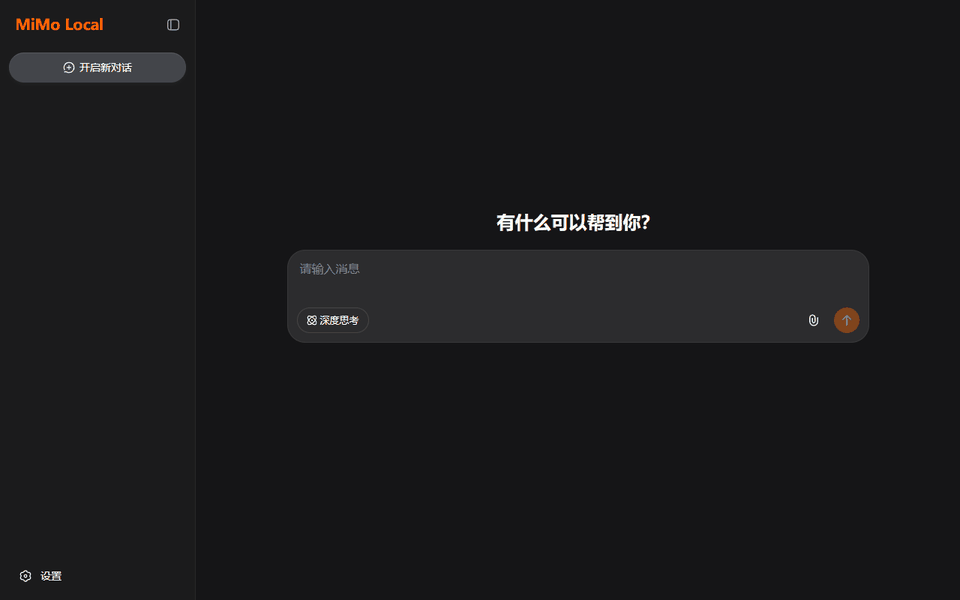
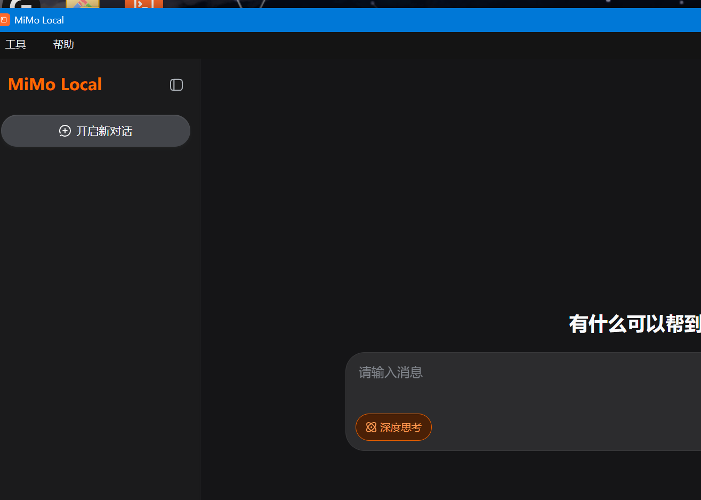
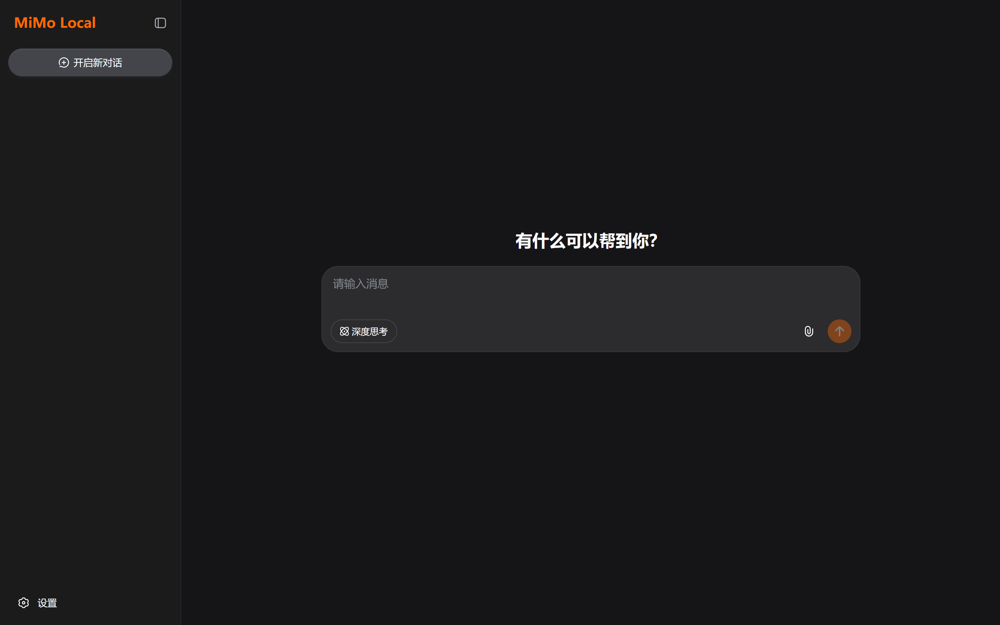
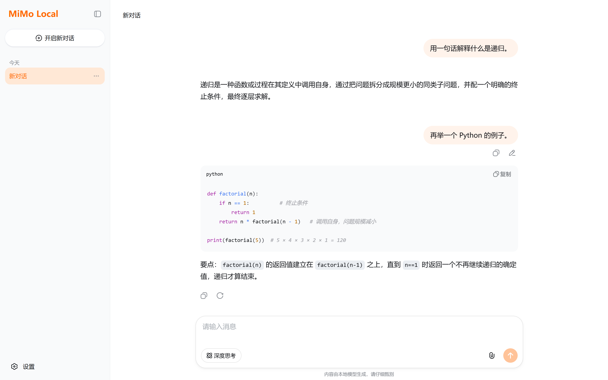
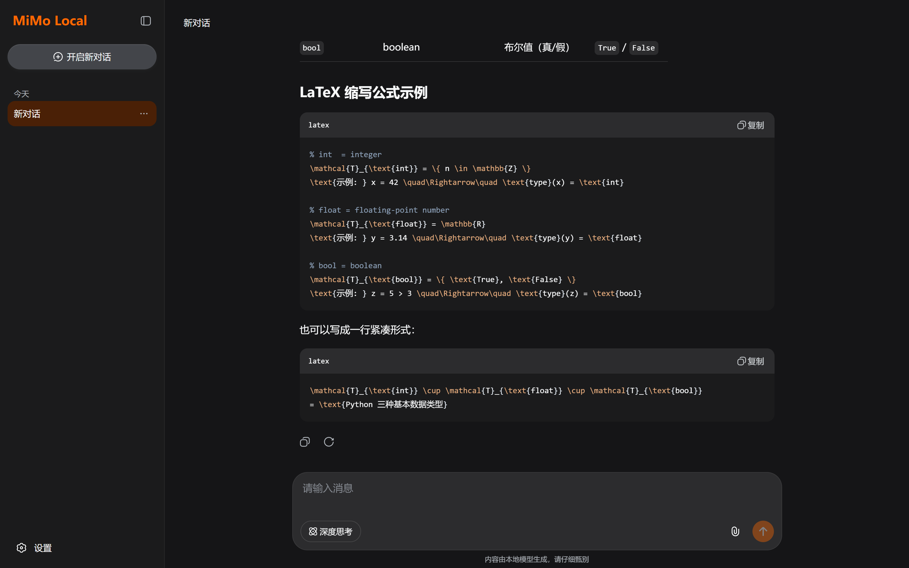
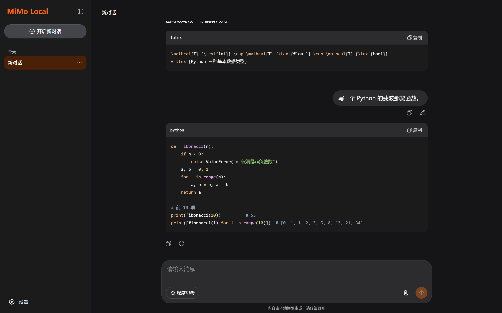
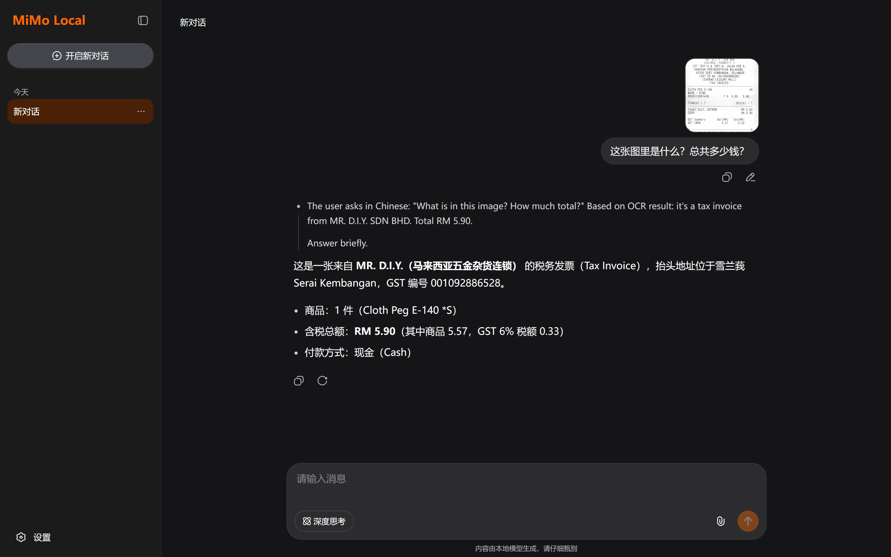
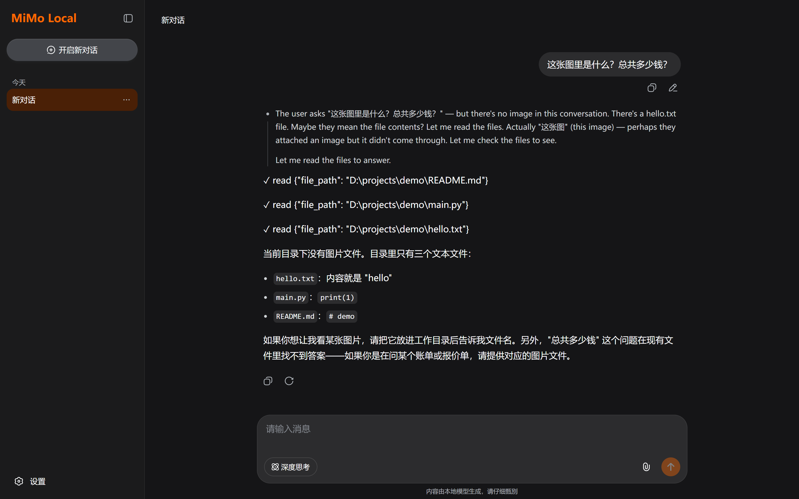
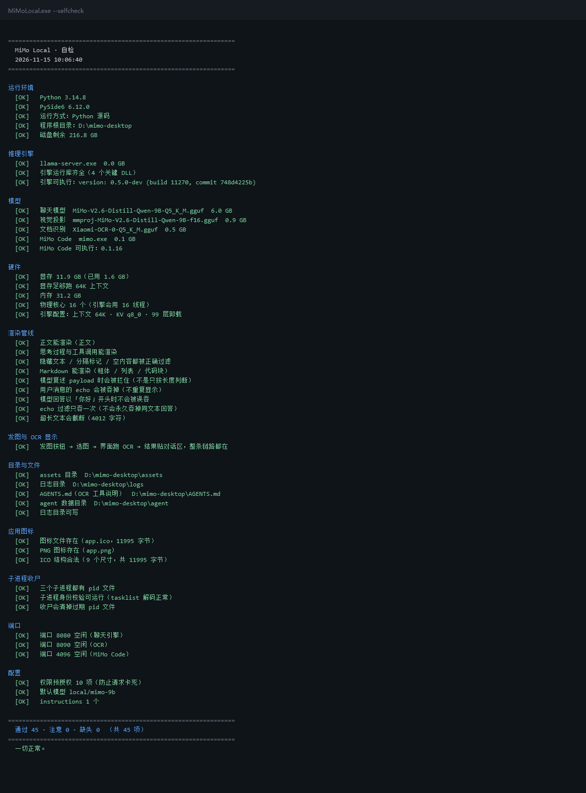

<p align="center">
  
</p>

<h1 align="center">MiMo Local</h1>

<p align="center">
  完全本地的 AI 编程助手<br>
  <b>MiMo Code + MiMo 9B + Xiaomi-OCR-0</b>，三个能力同时在线<br>
  <sub>不联网 · 不需要账号 · 所有数据在本机</sub>
</p>





聊天界面基于 [DeepSeek 官方开源的 chat-demo](https://github.com/deepseek-ai/chat-demo)（MIT）
改造：把 API 指向本机 llama-server，去掉所有云端能力，换成小米橙配色。

---

## 它是什么

三个东西**同时**在跑，不是切换：

| 能力 | 是什么 | 端口 |
|---|---|---|
| **MiMo Code** | AI 编程 agent 引擎（读写文件、执行命令、多轮工具调用） | 4096 |
| **MiMo V2.6 9B** | 主模型，64K 上下文，带视觉投影 | 8080 |
| **Xiaomi-OCR-0** | 文档识别，桥在收到图片时自动调用；模型也能通过 `--ocr` 主动调 | 8090 |

关键点：**OCR 不是一个独立的 Tab，是模型能调用的一个工具。**

你发一张图，协议桥先把 OCR 跑完，把识别文字拼进请求 —— 模型基于这段文字回答，
不是转述。

```
你：这张收据多少钱？  + 收据图片
   ↓
桥提取 base64 → 落临时文件 → 跑 OCR（8090）
   ↓
拼成「用户问题 + 图片识别结果 + 不要照抄」发给 MiMo Code
   ↓
9B 基于全文回答「RM 5.90，买的是 CLOTH PEG」
```

模型需要自己读文件、跑命令时，走的是 MiMo Code 的工具调用（bash / read / edit / glob）。
每个调用在对话里占一行（`✓ bash {...}`），失败是 `✗`，不刷屏。

---

## 一个界面，三个引擎

主窗口就是聊天界面。所有桌面侧功能在顶部菜单栏：

```
引擎 → 启动引擎 · 停止引擎 · 选择项目目录
工具 → 自检 · 声明断言 · 生成诊断报告 · 切换模型 · 打开日志目录 · 清理旧会话
帮助 → 关于
```

**清理旧会话**：chat-demo 的「删除对话」只删本地 IndexedDB，MiMo Code 的
session 还留在磁盘上。这个菜单项筛出 7 天没动过的，确认后删掉。

底部状态栏显示 chat-demo 没有的三样信息：

```
引擎就绪 | D:\projects\demo          上下文 45K/64K（70%） · MiMo-V2.6-9B + OCR 在线
```

- **引擎状态** —— 未启动 / 启动中 / 就绪
- **项目目录** —— 当前 `mimo serve` 的工作目录
- **上下文占用** —— 每回合结束后从 MiMo Code 的 token 统计更新



聊天、多会话、Markdown、工具调用展示、看图这些和 chat-demo 重合的部分
只保留 chat-demo 的实现，旧 PySide6 界面已移除。

---

## 聊天界面

深色和浅色都跟系统走：

<table>
<tr>
<td width="50%"><br>
<b>深色主题</b><br>小米橙配色，代码高亮 + 一键复制</td>
<td width="50%"><br>
<b>浅色主题</b><br>多轮对话、气泡区分、行内代码</td>
</tr>
<tr>
<td><br>
<b>Markdown / 表格 / 代码块</b><br>官方前端自带的渲染层，比自绘的强得多</td>
<td><br>
<b>多会话</b><br>左侧按时间分组，可重命名、删除、导出</td>
</tr>
</table>

---

## 三个引擎在同一个界面里

不用切界面，聊天、工具调用、看图都在这里发生：

<table>
<tr>
<td width="50%"><br>
<b>发图 → OCR → 回答</b><br>收据的 OCR 结果直接当事实依据，模型基于全文回答</td>
<td width="50%"><br>
<b>工具调用</b><br>模型自己 read 文件、跑命令，每一步一行 ✓</td>
</tr>
</table>

菜单栏里还有自检：



---

## 为什么做这个

这不是「又一个本地 AI 桌面应用」。市面上那些（LM Studio、Jan、Ollama 前端）
都是**通用聊天**，而这个是**只给一个人用的工具**：

- 不要登录、不要账号、不要云同步
- 不要模型市场、不要一堆用不上的设置
- 打开就能编程，模型在本地，OCR 随时可用

它是从 [portable-ai-usb](../portable-ai-usb)（U 盘版）拆出来的——
那个项目要解决「插到陌生电脑上就能用」，这个项目只解决「我自己电脑上顺手」。

---

## 准备文件

仓库**不包含**模型和引擎（太大）。你需要自己准备：

```
D:\llama.cpp\llama-b11270-bin-win-cuda-13.4-x64\
    └─ llama-server.exe                    ← llama.cpp 官方预编译包

D:\models\MiMo-9B-GGUF\
    ├─ MiMo-V2.6-Distill-Qwen-9B-Q5_K_M.gguf   （6.02 GB）
    └─ mmproj-MiMo-V2.6-Distill-Qwen-9B-f16.gguf（0.86 GB）

<项目目录>\assets\
    ├─ mimo.exe                            ← MiMo Code 0.1.16（约 130 MB）
    └─ ocr\
        ├─ Xiaomi-OCR-0-Q5_K_M.gguf        （0.54 GB）
        └─ mmproj-Xiaomi-OCR-0-F16.gguf    （0.19 GB）
```

路径写死在 `config.py` 里。换位置就改那个文件——**故意不做自动发现**，
少一层推断就少一处出错的可能。

---

## 运行

### 从源码

```bash
uv pip install PySide6-Essentials PySide6-Addons   # Addons 带 QtWebView
python main.py
```

### 改前端（chat-demo）

`webui/` 是构建产物，不是手写代码。上游是
[deepseek-ai/chat-demo](https://github.com/deepseek-ai/chat-demo)（MIT），
本地改造在 `D:\chat-demo`：

```powershell
cd D:\chat-demo
$env:API_ORIGIN = "http://127.0.0.1:8766"      # 指向协议桥
$env:LOCAL_BACKEND = "1"                       # 关掉所有云端能力
$env:NODE_ENV = "production"
pnpm run build                                  # 输出到 dist\
```

然后把 `D:\chat-demo\dist\*` 覆盖到 `webui\`。

`LOCAL_BACKEND=1` 会改掉这些（用 rspack 的 DefinePlugin 在构建期写死）：

| 位置 | 改了什么 |
|---|---|
| `services/api/client.ts` | 端点从 `/anthropic/v1` 换成 `/v1` |
| `services/settings.ts` | `apiKey` 默认 `'local'`，智能搜索关掉 |
| `services/chat/store.ts` | 模型固定 `mimo-local`，systemTools 返回空 |
| `services/chat/reply.ts` | 附件走 base64 内联，不用 Files API |
| `components/chatInput/ChatInput.tsx` | 搜索开关和语音按钮不渲染 |
| `components/messages/AssistantMessage.tsx` | 朗读按钮不渲染 |
| `app/theme.css` | 追加小米橙 token `#FF6900` |

**没改上游代码的地方**：渲染层（Markdown / 代码高亮 / 表格 / KaTeX）全部原样保留。

### 打包成 exe

用 spec，**不要手写命令行**：

```powershell
python -m PyInstaller MiMoLocal.spec --noconfirm
```

`MiMoLocal.spec` 里有两件手写命令行容易漏的东西：

- `('webui', 'webui')` —— chat-demo 的构建产物（153 个文件）
- `PySide6/plugins/webview/*.dll` —— **漏了运行时报 `No WebView plug-in found!`**，
  而且窗口化程序会静默退出，看不到任何报错

`--add-data "VERSION.txt;."` 也不能漏：安装器的版本号在打包后读不到
`config.py`，会回退读 `VERSION.txt`；两个都没有就写 `0.0.0`。

打包完**必须跑一次** `tools\verify_packaged.ps1` —— 它用临时目录当安装位置，
验证 frozen 分支、`--ocr` 子命令、settings 位置、卸载串，三条断言都不需要显卡：

```powershell
pwsh -File tools\verify_packaged.ps1              # 重新打包 + 验证
pwsh -File tools\verify_packaged.ps1 -SkipBuild   # 用现有 dist\ 验证
```

打包出来的 exe 需要能在旁边找到 `assets/`。找不到时会回退到开发目录
（见 `config.py` 的 `ASSETS_FALLBACK`）。

---

## 怎么用

1. **菜单 → 引擎 → 选择项目目录**，挑一个项目文件夹
2. **菜单 → 引擎 → 启动引擎**，等约 20 秒（三个引擎一起起来）
3. 直接说要做什么
4. **要看图就点输入框右下角的回形针**（附件）。发送时：

```
你选图 → 输入框里出现缩略图
      → 桥提取 base64、落临时文件、跑本地 OCR（约 1.5 秒）
      → 识别文字拼进请求（带「不要照抄」的指令）
      → 模型基于全文回答
```

**为什么是桥跑 OCR，而不是等模型调工具**：模型调 `--ocr` 时结果写进文件，
还得再读一次 —— 9B 经常念不全，而且要多一轮工具调用。桥直接跑，
一次请求内就把 OCR 结果给到模型。

**菜单 → 工具**里有：

- **自检** —— 一眼看出哪里坏了（项数写在输出里，别在这里硬编码）
- **声明断言** —— README 的承诺是否被代码兑现
- **生成诊断报告** —— 硬件 / 引擎配置 / 模型指纹 / 日志尾部，一份文本
- **切换模型** —— 扫描模型目录换一个；状态存在 `settings.json`，重启生效
- **打开日志目录**

---

## 资源占用

实测（RTX 5070 Ti Laptop 12 GB / 32 GB 内存）：

| 组件 | 显存 |
|---|---|
| MiMo 9B（64K, KV q8_0, flash-attn） | +8317 MiB |
| Xiaomi-OCR-0 | +1358 MiB |
| MiMo Code | 0 |
| **三个同时在线** | **11116 / 12227 MiB（余 1111）** |

**11 GB 显存是门槛。** 更低的话会自动降级：OCR 改成按需启动，
上下文按显存自动压小（见 `core/hardware.py`）。

---

## 已知限制

**这一节比上面所有内容都重要。** 9B 模型能力有限，不要期待它像云端大模型。

### 模型层面

- **会重复调工具。** 实测一次简单任务会调 10 次以上工具，不少是重复试错。
- **长任务会飘。** 超过十几步之后容易忘记目标，开始做无关的事。
- **会用 Unix 命令。** 在 Windows 上试 `cat`、`ls`、`2>/dev/null`，失败后才知道换。
- **中文写文件可能乱码。** 它首选 shell 而不是自带的 write_file，
  而 Windows cmd 会把中文写成 `????`。看到文件被弄坏就是这个原因。

**适合**：小范围、目标明确的改动（「修一下这个函数的返回值」）。
**不适合**：大重构、跨多文件的改动、需要理解整个项目的任务。

### 工程层面

- **必须 64K 上下文。** 32K 下 MiMo Code 的系统提示 + 工具定义吃掉 27K，
  跑两三轮就报上下文超限（实测 277 秒后失败）。这是硬要求，不是建议。
- **切换项目目录要重启。** `mimo serve` 的工作目录是启动时定的，
  API 上改不了（试过 `body.directory`、`path`、`worktree`、各种 header，全不生效）。
- **权限必须预授权。** 不预授权的话，模型访问目录外文件时会弹权限请求，
  然后**永远等下去**（实测卡 100 秒）。配置里已经全放开了。
- **打包后的 exe 启动慢 2–3 秒**（onefile 要解压）。想快就用 onedir。
- **会话按第一条消息的哈希识别。** 桥没有别的东西可用 —— Anthropic 的
  请求头/请求体里都没有会话 id，chat-demo 也没加。后果：两个不同对话
  如果第一条消息一模一样，会共用一个 MiMo Code session（罕见）。
- **换模型要重启引擎。** 模型在 MiMo Code 的配置里写死，
  和换项目目录同理，热切换做不到。

### 环境层面

- **只支持 Windows。** 依赖 CUDA / Windows 路径 / cmd。
- **要求 NVIDIA 显卡。** 没有 CUDA 会退回 CPU，9B 模型在 CPU 上慢到没法用。
- **不使用任何网络。** 反过来说：模型和引擎必须提前放好，程序不会帮你下载。`agent` 的 `web` / `webfetch` 权限也设为 `deny`，模型自己抓不了网页。

---

## 技术细节

想改的话，几个关键位置：

| 文件 | 干什么 |
|---|---|
| `config.py` | 所有路径、端口、采样参数。改配置只改这里 |
| `core/hardware.py` | 按显存推导上下文 / KV 精度 / 卸载层数（`derive_ctx` / `derive_kv` 是纯函数，可单测） |
| `core/engine.py` | 起停 llama-server（两个引擎共用）+ pid 收尸 |
| `core/agent.py` | 起停 `mimo serve`、写配置、订阅事件流、调 API |
| `core/agent_bridge.py` | **协议桥**：Anthropic 格式 → MiMo Code session API，含图片 OCR |
| `core/render.py` | 判断一个 part 要不要显示（纯函数，不依赖 Qt，自检直接喂假数据） |
| `core/settings.py` | 运行期状态（当前模型等），原子写 `settings.json` |
| `core/logs.py` | 日志轮转 |
| `ui_web.py` | 内嵌 WebView + 静态服务，承载 chat-demo |
| `ui_qt.py` | 主窗口：菜单栏 + 状态栏 + 深色标题栏 |
| `webui/` | chat-demo 的构建产物（`pnpm build` 输出，153 个文件） |
| `tools/ocr.py` | OCR 工具，模型通过 bash 调它 |
| `tools/selfcheck.py` | 自检（含渲染管线检查） |
| `tools/claims.py` | **声明断言**：把本文档的承诺变成会失败的检查 |
| `tools/report.py` | 诊断报告 |
| `tools/verify_packaged.ps1` | 打包后路径验证（不需要显卡） |
| `agent/config/AGENTS-ocr.md` | **运行时生成**的「你有 OCR 工具」说明 |

### 协议桥为什么要存在

chat-demo 说的是 Anthropic Messages 格式（`POST /v1/messages` + SSE），
而 MiMo Code 是 session API（`POST /session/{id}/message` + `GET /event`）——
两边不通。桥做四件事：

1. **翻译请求**：Anthropic messages → session 创建 + 一条文本消息
2. **翻译事件**：`message.part.updated` → `content_block_delta`
3. **处理图片**：Anthropic base64 → 临时文件 → OCR → 拼进消息
4. **接管停止**：见下

```
chat-demo --Anthropic--> 桥(8766) --session API--> MiMo Code(4096)
                                                      |-> 9B (8080)
                                                      |-> OCR (8090)
```

桥只监听 `127.0.0.1`，不对外。

#### 停止按钮

点停止会**真的中断后端**，不只是断前端。桥把「SSE 写入失败」当作停止信号，
当场调 MiMo Code 的 `/session/{id}/abort`。

关于 `AGENTS-ocr.md`：模型不是天生知道有 OCR 的。这份文件在每次启动时**按当前
安装位置生成**（`core/agent.py::_write_agents_md`），然后通过 MiMo Code 的
`instructions` 配置注入到系统提示里。仓库根目录那份静态 `AGENTS.md` 只是源码
模式的占位，实际生效的是生成出来的那份。

打包成 exe 后，`tools/ocr.py` 进了压缩包、磁盘上没有脚本文件，所以说明里会改用
`MiMoLocal.exe --ocr <图片>` 子命令 —— 结果写到图片旁边的同名 `.md`。

---

## 自检 / 断言 / 测试

三个都是只读的，随时可以跑：

```bash
python main.py --selfcheck          # 环境检查
python main.py --claims             # 文档承诺 vs 代码
python tools/test_bridge.py         # 桥的回归测试
```

- **自检** —— 路径、引擎、模型、硬件、渲染管线、端口、配置，共 45 项。
  它真的读文件、查版本、试端口、喂假数据验证渲染，不是「能不能启动」那种敷衍检查。
- **断言** —— 本文档的每一条承诺是否被代码兑现。比如「说不联网」
  → 断言 agent 的 `web/webfetch` 是 `deny`；「说显存低会自动降级」
  → 断言 `derive_ctx` 每档边界都对。不符时要么改代码，要么改文档。
- **桥的测试** —— 工具调用 / 多轮上下文 / 图片 OCR / 中断，四个场景。
  改 `core/agent_bridge.py` 之后跑一下。

菜单栏的**工具**里也有前两个入口 —— 只能靠命令行跑的工具，实际上没人跑。


---

## 许可

本项目代码：[Apache-2.0](LICENSE)

第三方组件（llama.cpp / MiMo Code / Qt / 模型）的许可各不相同，
**尤其是模型文件，请自己去官方发布页确认** —— 见 [THIRD-PARTY.md](THIRD-PARTY.md)。

---

## 顺带一句

这是自用工具，不是产品。没有安装包签名、没有自动更新、没有用户引导。

它只是把三个本地能力拼成一个我每天能用的窗口。
