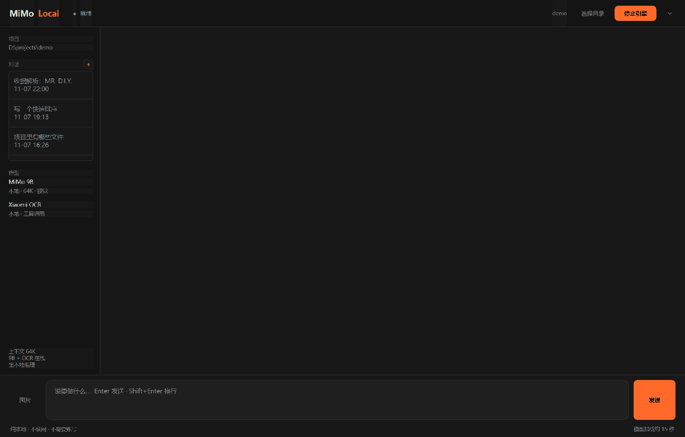
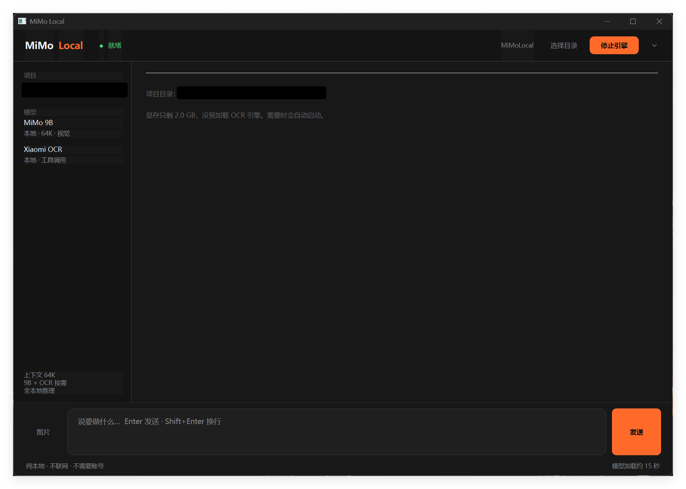
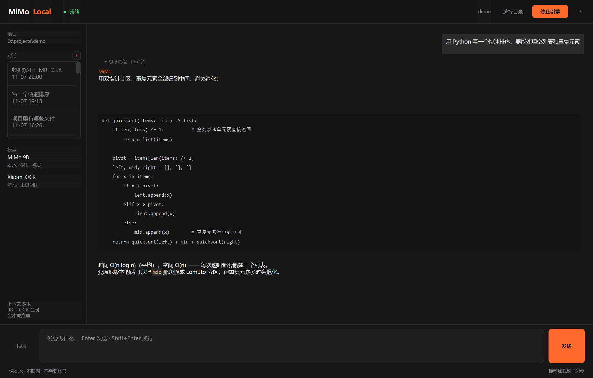
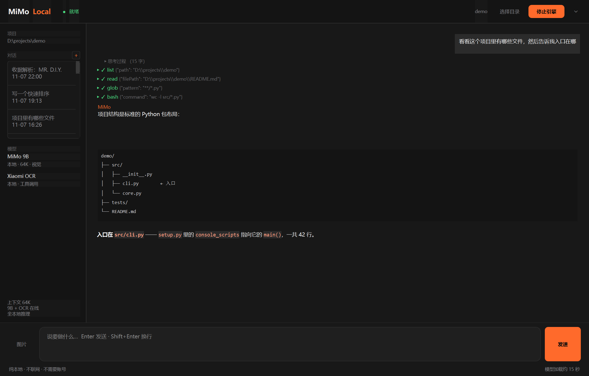
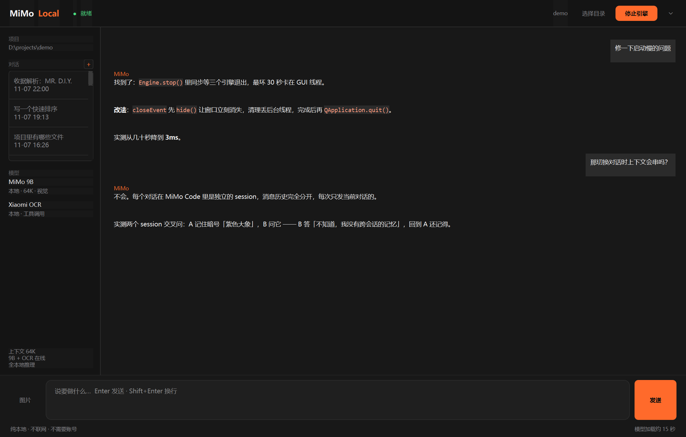

<p align="center">
  
</p>

<h1 align="center">MiMo Local</h1>

<p align="center">
  完全本地的 AI 编程助手<br>
  <b>MiMo Code + MiMo 9B + Xiaomi-OCR-0</b>，三个能力同时在线<br>
  <sub>不联网 · 不需要账号 · 所有数据在本机</sub>
</p>



一个 Windows 桌面程序。打开就是编程界面，模型跑在本地显卡上，
需要看图时点左下角「图片」—— OCR 出来的文字直接成为模型的依据，
不需要切换模式，也不需要切窗口。

<p align="center"><i>动图：输入问题 → 选图 → 界面跑 OCR → 模型基于识别结果回答</i></p>

---

## 界面

<table>
<tr>
<td width="50%"><br>
<b>看图问答</b><br>发一张收据，OCR 结果是模型的事实依据，不是让它转述</td>
<td width="50%"><br>
<b>写代码</b><br>Markdown 代码块、粗体、列表都正确渲染</td>
</tr>
<tr>
<td><br>
<b>工具调用</b><br>读文件、跑命令，每个步骤单独折叠，不刷屏</td>
<td><br>
<b>多轮对话</b><br>每个对话独立 session，上下文互不干扰</td>
</tr>
</table>

---

## 它是什么

三个东西**同时**在跑，不是切换：

| 能力 | 是什么 | 端口 |
|---|---|---|
| **MiMo Code** | AI 编程 agent 引擎（读写文件、执行命令、多轮工具调用） | 4096 |
| **MiMo V2.6 9B** | 主模型，64K 上下文，带视觉投影 | 8080 |
| **Xiaomi-OCR-0** | 文档识别，作为工具挂在模型手里 | 8090 |

关键点：**OCR 不是一个独立的 Tab，是模型能调用的一个工具。**

你点「图片」发一张图，界面先把 OCR 跑完（结果贴进对话，你能看到原文），
再把识别文字当成事实依据交给模型 —— 它基于这段文字回答，不是转述。

```
你：这张收据多少钱？
   ↓
界面跑 OCR（1.5 秒）→ 缩略图 + 折叠的识别原文进对话
   ↓
同时把识别文字拼进请求 → 9B 模型基于全文回答「RM 5.90，买的是 CLOTH PEG」
```

模型需要自己读文件、跑命令时，走的是 MiMo Code 的工具调用（bash / read / edit / glob）。
每一步都是可折叠的，不展开就看不到，不会把回答挤走。

---

## 为什么做这个

这不是「又一个本地 AI 桌面应用」。市面上那些（LM Studio、Jan、Ollama 前端）
都是**通用聊天**，而这个是**只给一个人用的工具**：

- 不要登录、不要账号、不要云同步
- 不要模型市场、不要一堆用不上的设置
- 打开就能编程，模型在本地，OCR 随时可用

它是从 [portable-ai-usb](../portable-ai-usb)（U 盘版）拆出来的——
那个项目要解决「插到陌生电脑上就能用」，这个项目只解决「我自己电脑上顺手」。

---

## 准备文件

仓库**不包含**模型和引擎（太大）。你需要自己准备：

```
D:\llama.cpp\llama-b11270-bin-win-cuda-13.4-x64\
    └─ llama-server.exe                    ← llama.cpp 官方预编译包

D:\models\MiMo-9B-GGUF\
    ├─ MiMo-V2.6-Distill-Qwen-9B-Q5_K_M.gguf   （6.02 GB）
    └─ mmproj-MiMo-V2.6-Distill-Qwen-9B-f16.gguf（0.86 GB）

<项目目录>\assets\
    ├─ mimo.exe                            ← MiMo Code 0.1.16（约 130 MB）
    └─ ocr\
        ├─ Xiaomi-OCR-0-Q5_K_M.gguf        （0.54 GB）
        └─ mmproj-Xiaomi-OCR-0-F16.gguf    （0.19 GB）
```

路径写死在 `config.py` 里。换位置就改那个文件——**故意不做自动发现**，
少一层推断就少一处出错的可能。

---

## 运行

### 从源码

```bash
uv pip install PySide6-Essentials   # 或 pip install
python main.py
```

### 打包成 exe

```powershell
pyinstaller --onefile --windowed --name MiMoLocal `
    --add-data "VERSION.txt;." `
    --exclude-module PySide6.QtWebEngineCore --exclude-module PySide6.QtWebEngineWidgets `
    --exclude-module PySide6.QtQml --exclude-module PySide6.QtQuick `
    --exclude-module PySide6.Qt3DCore --exclude-module PySide6.QtMultimedia `
    --collect-submodules tools main.py
```

`--add-data "VERSION.txt;."` **不能漏**：安装器的版本号在打包后读不到
`config.py`，会回退读 `VERSION.txt`；两个都没有就写 `0.0.0`。

打包完**必须跑一次** `tools\verify_packaged.ps1` —— 它用临时目录当安装位置，
验证 frozen 分支、`--ocr` 子命令、settings 位置、卸载串，三条断言都不需要显卡：

```powershell
pwsh -File tools\verify_packaged.ps1              # 重新打包 + 验证
pwsh -File tools\verify_packaged.ps1 -SkipBuild   # 用现有 dist\ 验证
```

打包出来的 exe 需要能在旁边找到 `assets/`。找不到时会回退到开发目录
（见 `config.py` 的 `ASSETS_FALLBACK`）。

---

## 怎么用

1. 点「选择目录」，挑一个项目文件夹
2. 点「启动引擎」，等约 20 秒（三个引擎一起起来）
3. 直接说要做什么
4. **要看图就点输入框左边的「图片」** —— 选一张（可多选），发送时：

```
你选图 → 对话里出现「📎 invoice.jpg」
       → 界面直接跑本地 OCR（不经过模型，约 1.5 秒）
       → 识别结果整段贴在对话里（等宽字体，可直接选中复制）
       → 同时把 OCR 文字一起喂给模型，它基于全文回答
```

**为什么是界面自己跑 OCR，而不是等模型调工具**：模型调 `--ocr` 时结果写进
文件，还得再读一次——用户看不到，9B 也经常念不全。界面直接跑，结果原样贴在
对话里，模型拿到的也是全文。

顶栏的 `⋯` 里有：

- **自检** —— 一眼看出哪里坏了（项数写在输出里，别在这里硬编码）
- **声明断言** —— README 的承诺是否被代码兑现
- **生成诊断报告** —— 硬件 / 引擎配置 / 模型指纹 / 日志尾部，一份文本
- **切换模型** —— 扫描模型目录换一个；状态存在 `settings.json`，重启生效
- **打开日志目录**

---

## 资源占用

实测（RTX 5070 Ti Laptop 12 GB / 32 GB 内存）：

| 组件 | 显存 |
|---|---|
| MiMo 9B（64K, KV q8_0, flash-attn） | +8317 MiB |
| Xiaomi-OCR-0 | +1358 MiB |
| MiMo Code | 0 |
| **三个同时在线** | **11116 / 12227 MiB（余 1111）** |

**11 GB 显存是门槛。** 更低的话会自动降级：OCR 改成按需启动，
上下文按显存自动压小（见 `core/hardware.py`）。

---

## 已知限制

**这一节比上面所有内容都重要。** 9B 模型能力有限，不要期待它像云端大模型。

### 模型层面

- **会重复调工具。** 实测一次简单任务会调 10 次以上工具，不少是重复试错。
- **长任务会飘。** 超过十几步之后容易忘记目标，开始做无关的事。
- **会用 Unix 命令。** 在 Windows 上试 `cat`、`ls`、`2>/dev/null`，失败后才知道换。
- **中文写文件可能乱码。** 它首选 shell 而不是自带的 write_file，
  而 Windows cmd 会把中文写成 `????`。看到文件被弄坏就是这个原因。

**适合**：小范围、目标明确的改动（「修一下这个函数的返回值」）。
**不适合**：大重构、跨多文件的改动、需要理解整个项目的任务。

### 工程层面

- **必须 64K 上下文。** 32K 下 MiMo Code 的系统提示 + 工具定义吃掉 27K，
  跑两三轮就报上下文超限（实测 277 秒后失败）。这是硬要求，不是建议。
- **切换项目目录要重启。** `mimo serve` 的工作目录是启动时定的，
  API 上改不了（试过 `body.directory`、`path`、`worktree`、各种 header，全不生效）。
- **权限必须预授权。** 不预授权的话，模型访问目录外文件时会弹权限请求，
  然后**永远等下去**（实测卡 100 秒）。配置里已经全放开了。
- **打包后的 exe 启动慢 2–3 秒**（onefile 要解压）。想快就用 onedir。

### 环境层面

- **只支持 Windows。** 依赖 CUDA / Windows 路径 / cmd。
- **要求 NVIDIA 显卡。** 没有 CUDA 会退回 CPU，9B 模型在 CPU 上慢到没法用。
- **不使用任何网络。** 反过来说：模型和引擎必须提前放好，程序不会帮你下载。`agent` 的 `web` / `webfetch` 权限也设为 `deny`，模型自己抓不了网页。

---

## 技术细节

想改的话，几个关键位置：

| 文件 | 干什么 |
|---|---|
| `config.py` | 所有路径、端口、采样参数。改配置只改这里 |
| `core/hardware.py` | 按显存推导上下文 / KV 精度 / 卸载层数（`derive_ctx` / `derive_kv` 是纯函数，可单测） |
| `core/engine.py` | 起停 llama-server（两个引擎共用）+ pid 收尸 |
| `core/agent.py` | 起停 `mimo serve`、写配置、订阅事件流、调 API |
| `core/render.py` | **决定一个 part 要不要显示**（纯函数，不依赖 Qt，自检直接喂假数据） |
| `core/settings.py` | 运行期状态（当前模型等），原子写 `settings.json` |
| `core/logs.py` | 日志轮转 |
| `ui_qt.py` | PySide6 界面 + 流式渲染 |
| `tools/ocr.py` | OCR 工具，模型通过 bash 调它 |
| `tools/selfcheck.py` | 自检（含渲染管线检查） |
| `tools/claims.py` | **声明断言**：把本文档的承诺变成会失败的检查 |
| `tools/report.py` | 诊断报告 |
| `tools/verify_packaged.ps1` | 打包后路径验证（不需要显卡） |
| `agent/config/AGENTS-ocr.md` | **运行时生成**的「你有 OCR 工具」说明 |

关于 `AGENTS-ocr.md`：模型不是天生知道有 OCR 的。这份文件在每次启动时**按当前
安装位置生成**（`core/agent.py::_write_agents_md`），然后通过 MiMo Code 的
`instructions` 配置注入到系统提示里。仓库根目录那份静态 `AGENTS.md` 只是源码
模式的占位，实际生效的是生成出来的那份。

打包成 exe 后，`tools/ocr.py` 进了压缩包、磁盘上没有脚本文件，所以说明里会改用
`MiMoLocal.exe --ocr <图片>` 子命令 —— 结果写到图片旁边的同名 `.md`。

---

## 自检与断言

两个都是只读的，随时可以跑：

```bash
python main.py --selfcheck   # 路径、引擎、模型、硬件、渲染管线、端口、配置
python main.py --claims      # 本文档的承诺是否被代码兑现
```

界面上在 `⋯` 菜单里也有这两个入口 —— 一个只能靠命令行跑的工具，实际上没人跑。

自检不是「程序能启动吗」那种敷衍检查。它**真的读文件、查版本、试端口、验证渲染管线**：

![自检输出：11 个分类 45 项全部 [OK]，包括引擎版本、模型指纹、显存推导、渲染管线、图标结构、子进程收尸、端口占用](docs/shot-selfcheck.png)

其中「渲染管线」那几项是这么来的：曾经有一次改动让**所有正文都不显示**——
`_on_part` 里多了个无条件的 `return`，界面只剩思考过程和工具卡片。
而当时的自检和断言全在查「某个字符串在不在源码里」，没有一条和
「用户能不能看见回答」有交集。现在这项会直接喂假数据给渲染函数验证。

`--claims` 值得单独说：它检查的是「README 说 X，代码是不是真的 X」。
比如「README 说显存低会自动降级」→ 断言 `derive_ctx` 每档边界都对；
「README 说不联网」→ 断言 agent 的 `web/webfetch` 是 `deny`；
「README 说换模型不改源码」→ 断言 `set_model` 不写文件。
不符的时候要么改代码，要么改这份文档，两者不能同时成立。

---

## 许可

本项目代码：[Apache-2.0](LICENSE)

第三方组件（llama.cpp / MiMo Code / Qt / 模型）的许可各不相同，
**尤其是模型文件，请自己去官方发布页确认** —— 见 [THIRD-PARTY.md](THIRD-PARTY.md)。

---

## 顺带一句

这是自用工具，不是产品。没有安装包签名、没有自动更新、没有用户引导。

它只是把三个本地能力拼成一个我每天能用的窗口。
